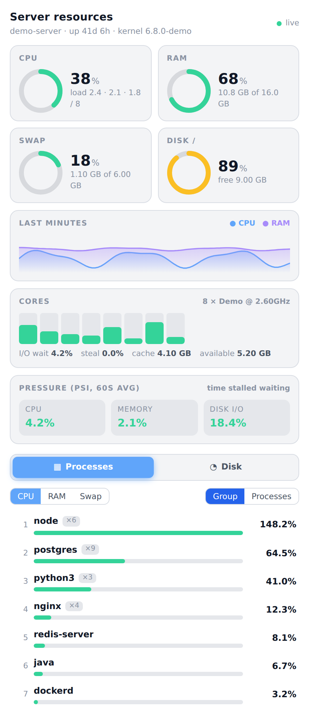
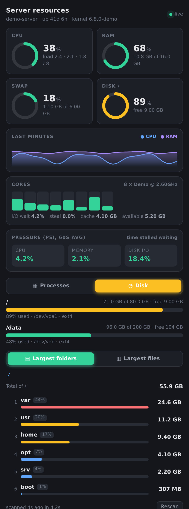

<p align="center">
  
</p>

<h1 align="center">dsh-server-resources</h1>

<p align="center">
  <b>See what is eating your server — without leaving DeepSeek Harness.</b><br>
  Live CPU, RAM, swap and disk, with a ranked list of the biggest consumers of each.
</p>

<p align="center">
  <a href="https://github.com/brungcm/dsh-server-resources/actions/workflows/test.yml"></a>
  
  
  
  
</p>

---

## Why

"The server is slow" is a question, not an answer. This plugin adds a **Resources** tab to the DSH right sidebar that answers the follow-ups in one place:

- *Is it CPU, memory, swap or disk?*
- *Which program is responsible — and how many copies of it are running?*
- *What is actually filling the disk?*

No SSH session, no `htop`, no `ncdu`, no extra service to install.

## Screenshots

<table>
  <tr>
    <td align="center"><b>Overview · dark</b></td>
    <td align="center"><b>Overview · light</b></td>
  </tr>
  <tr>
    <td></td>
    <td></td>
  </tr>
  <tr>
    <td align="center"><b>Disk drill-down · dark</b></td>
    <td align="center"><b>Disk drill-down · light</b></td>
  </tr>
  <tr>
    <td></td>
    <td></td>
  </tr>
</table>

<sub>All screenshots use made-up demo data (see [`docs/demo`](docs/demo)). They show no real server.</sub>

## Features

| | |
|---|---|
| **Gauges** | CPU, RAM, swap and the fullest disk, colour-coded green → amber → red. |
| **History** | CPU and RAM over the last few minutes. |
| **Per-core bars** | Spot one saturated core hiding behind a "low" average. |
| **I/O wait · steal · cache** | The numbers that explain *why* a "free" machine still feels slow. |
| **Pressure (PSI)** | How much time tasks spent *stalled* waiting for CPU, memory or disk (Linux pressure-stall info). |
| **Processes tab** | Top consumers of **CPU**, **RAM** or **swap**. Group by program (`claude ×4`) or list each process with PID, user and command line. |
| **Disk tab** | Usage bar for every mounted filesystem, then **largest folders** (click to drill in, breadcrumb to go back) and **largest files** (20 MB / 100 MB / 500 MB / 1 GB). |
| **Theme-aware** | Follows the DSH light / dark theme. |

## Install

Requires [`dsh-better-sidebar`](https://www.npmjs.com/package/dsh-better-sidebar) ≥ 0.30 (the plugin renders inside its sidebar).

```sh
# from GitHub
dsh plugin --profile <your-profile> add github:brungcm/dsh-server-resources
```

Then open the **+** menu of the right sidebar and choose **Resources**.

<details>
<summary>Manual / local install</summary>

```sh
git clone https://github.com/brungcm/dsh-server-resources
dsh plugin --profile <your-profile> add ./dsh-server-resources
```

The bundle patch it applies is [`cordis.patch.yml`](cordis.patch.yml): one `insert` row named `server-resources`.
</details>

## Safe by design

- **Read-only.** It never kills a process, deletes a file or changes a setting.
- **No dependencies, no network.** It reads `/proc` and runs `df`, `du` and `find` with fixed arguments through `spawn` — never a shell string, never user input in a command position.
- **Gentle on the machine.** Disk scans run under `ionice -c3 nice -n19`, one at a time, with a 150 s limit, a 5 min cache and at most 4 queued. The overview is sampled once per second no matter how many tabs are open, and polling stops while the tab is hidden.
- **Guarded paths.** `/proc`, `/sys`, `/dev` and `/run` cannot be scanned; every path goes through `realpath` and must be an existing directory.
- **Behind DSH's own auth.** The routes are served through DSH's connection layer and are only reachable by the signed-in owner.

> **Heads-up:** the Processes tab shows each process's **full command line**, which on some systems contains secrets passed as arguments. That is the same information any local user can read with `ps`. Do not expose your DSH instance publicly without authentication.

## Limitations

- **Linux only** (reads `/proc`). macOS and Windows are not supported.
- Numbers describe the **host**; container (cgroup) limits are not shown.
- If `/proc` is mounted with `hidepid`, processes of other users are not readable; the tab shows how many were skipped.
- Disk scans of very large trees can take up to 2.5 minutes and then return a partial result (clearly marked).

## How it works

```
 browser (React tab)  ──poll 2.5 s──▶  GET /api/dsh-server-resources/overview
                                        └─ /proc/stat · meminfo · loadavg · pressure/* · <pid>/{stat,statm,status,cmdline} · df
                      ──on demand───▶  GET /api/dsh-server-resources/disk/dirs?path=…
                                       GET /api/dsh-server-resources/disk/files?path=…&minMb=…
                                        └─ ionice -c3 nice -n19 du / find   (one at a time, cached)
```

Source: [`lib/index.js`](lib/index.js) (host, ~430 lines) and [`lib/client.js`](lib/client.js) (UI, ~380 lines). No build step.

## Development

```sh
npm test                                  # node --test, nothing to install
PW_FROM=<dir-with-playwright-core>/ node docs/demo/render.mjs <chrome> <react.iife.js>   # regenerate screenshots from fictional data
```

Contributions and issues are welcome.

## License

[MIT](LICENSE) © brungcm
