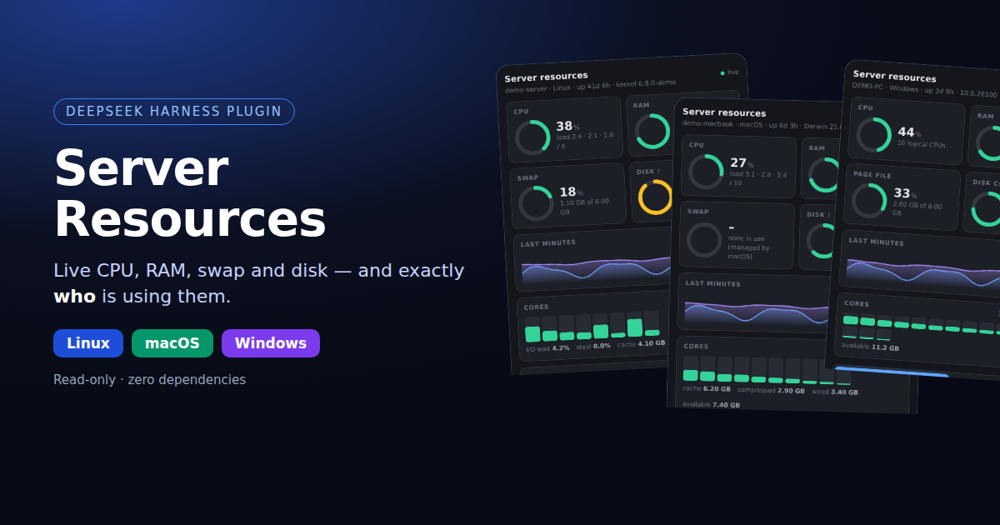
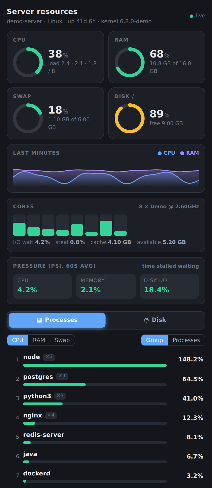
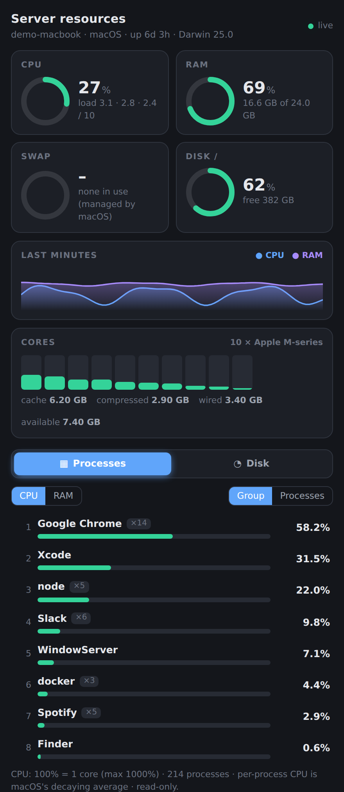
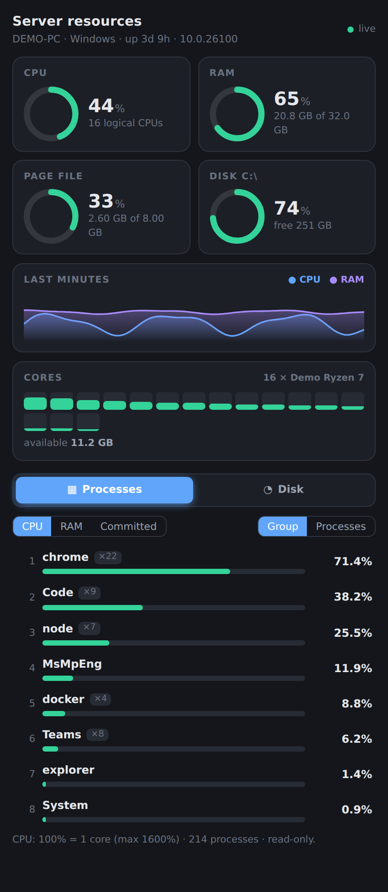
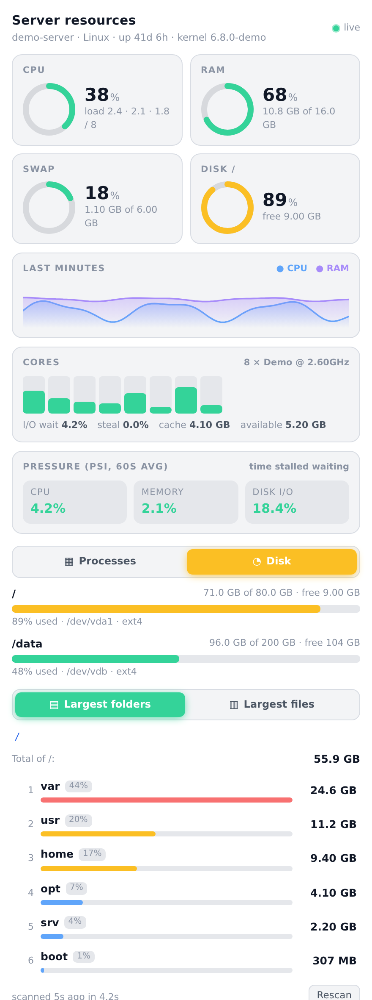
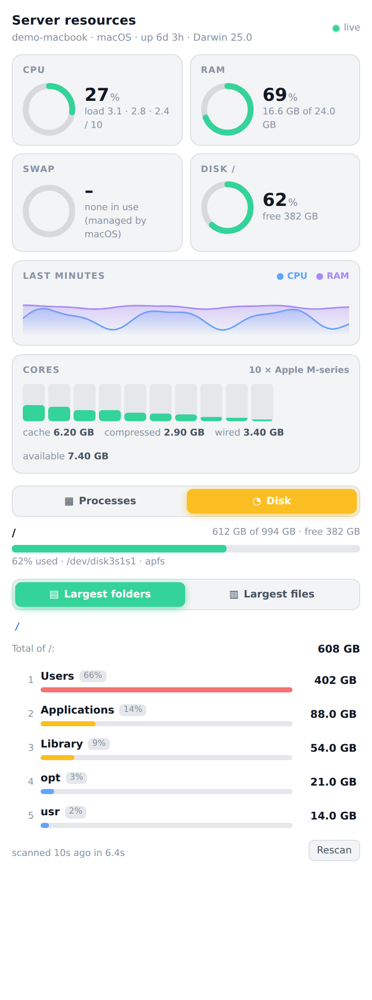
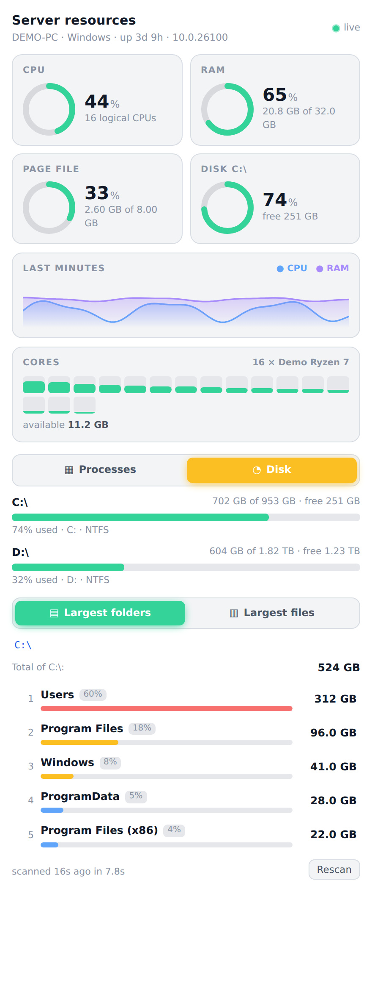

<p align="center">
  
</p>

<h1 align="center">dsh-server-resources</h1>

<p align="center">
  <b>See what is eating your machine — without leaving DeepSeek Harness.</b><br>
  Live CPU, RAM, swap and disk on <b>Linux, macOS and Windows</b>, with a ranked list of the biggest consumers of each.
</p>

<p align="center">
  <a href="https://github.com/brungcm/dsh-server-resources/actions/workflows/test.yml"></a>
  <a href="https://www.npmjs.com/package/dsh-server-resources"></a>
  
  
  
  
</p>

---

## Why

"The machine is slow" is a question, not an answer. This plugin adds a **Resources** tab to the DSH right sidebar that answers the follow-ups in one place:

- *Is it CPU, memory, swap or disk?*
- *Which program is responsible — and how many copies of it are running?*
- *What is actually filling the disk?*

No SSH session, no `htop`, no Activity Monitor, no Task Manager, no `ncdu`, no extra service to install.

## Screenshots

Same panel on every OS — it hides what an OS cannot measure instead of showing zeros.

<table>
  <tr>
    <td align="center"><b>Linux</b></td>
    <td align="center"><b>macOS</b></td>
    <td align="center"><b>Windows</b></td>
  </tr>
  <tr>
    <td></td>
    <td></td>
    <td></td>
  </tr>
  <tr>
    <td></td>
    <td></td>
    <td></td>
  </tr>
</table>

<sub>Dark and light themes are both supported (all variants are in [`docs/images`](docs/images)). Every screenshot uses made-up demo data (see [`docs/demo`](docs/demo)); none shows a real machine.</sub>

## Features

| | Linux | macOS | Windows |
|---|:--:|:--:|:--:|
| **Gauges** — CPU, RAM, swap / page file, fullest disk (green → amber → red) | ✅ | ✅ | ✅ |
| **History** — CPU and RAM over the last few minutes | ✅ | ✅ | ✅ |
| **Per-core bars** — spot one saturated core behind a "low" average | ✅ | ✅ | ✅ |
| **Processes** — top consumers of CPU and RAM, grouped by program (`claude ×4`) or one by one with PID, user and command line | ✅ | ✅ | ✅ |
| **Swap ranking** per process | ✅ | — | ✅ *(committed memory)* |
| **Disk tab** — every volume, largest folders (click to drill in), largest files (20 MB … 1 GB) | ✅ | ✅ | ✅ |
| **I/O wait · steal · page cache** | ✅ | cache only | — |
| **Pressure (PSI)** — time stalled waiting for CPU, memory, disk | ✅ | — | — |
| **Theme-aware** (follows DSH light / dark) | ✅ | ✅ | ✅ |

`—` means the OS does not expose it to normal programs; the panel simply leaves it out. Details and the exact commands used on each OS: [docs/PLATFORMS.md](docs/PLATFORMS.md).

## Install

Requires [`dsh-better-sidebar`](https://www.npmjs.com/package/dsh-better-sidebar) ≥ 0.30 (the plugin renders inside its sidebar) and Node.js ≥ 20.

```sh
# from npm
dsh plugin --profile <your-profile> add dsh-server-resources

# or straight from GitHub
dsh plugin --profile <your-profile> add github:brungcm/dsh-server-resources
```

Then open the **+** menu of the right sidebar and choose **Resources**.

<details>
<summary>Manual / local install</summary>

```sh
git clone https://github.com/brungcm/dsh-server-resources
dsh plugin --profile <your-profile> add ./dsh-server-resources
```

The bundle patch it applies is [`cordis.patch.yml`](cordis.patch.yml): one `insert` row named `server-resources`.
</details>

### What it needs from the OS

| OS | Needs | Notes |
|---|---|---|
| Linux | `/proc`, `df`, `du`, `find`, `ionice`, `getconf` | All present on any distro; BusyBox/Alpine work too (no PSI on old kernels). |
| macOS | `sysctl`, `vm_stat`, `ps`, `df`, `mount` | Ships with macOS. Tested on macOS 26 (Apple silicon). |
| Windows | PowerShell — `pwsh` (7+) or the built-in `powershell.exe` (5.1) | Prefers `pwsh`: it starts ~15× faster. Tested on Windows Server 2025. |

## Safe by design

- **Read-only.** It never kills a process, deletes a file or changes a setting.
- **No dependencies, no network.** Linux reads `/proc`; macOS runs `sysctl`/`vm_stat`/`ps`/`df`; Windows runs **one** PowerShell script that only calls `Get-CimInstance`. Commands are started with a fixed argument list (never a shell string), and the PowerShell script is sent with `-EncodedCommand`, so nothing from the browser is ever interpolated into it.
- **Gentle on the machine.** Linux disk scans run under `ionice -c3 nice -n19`; macOS and Windows use a built-in walker that yields to the event loop. All scans run one at a time, with a 150 s limit, a 5 min cache and at most 4 queued. The overview is sampled at most once per second (more slowly on Windows) however many tabs are open, and polling stops while the tab is hidden.
- **Guarded paths.** `/proc`, `/sys`, `/dev` and `/run` cannot be scanned on Linux/macOS; every path goes through `realpath` and must be an existing directory; the walker never follows symlinks or junctions and never leaves the volume it started on.
- **Behind DSH's own auth.** The routes are served through DSH's connection layer and are only reachable by the signed-in owner.

> **Heads-up:** the Processes tab shows each process's **full command line**, which on some systems contains secrets passed as arguments. That is the same information any local user can read with `ps`, `Get-CimInstance` or Task Manager. Do not expose your DSH instance publicly without authentication.

## Limitations

- **Numbers describe the host** DSH runs on; container (cgroup) limits are not shown.
- **macOS:** per-process CPU is macOS's own decaying average (it lags a sudden spike); swap is "none" until macOS actually needs it; no per-process swap.
- **Windows:** one sample takes ~1–2 s (PowerShell + CIM), so the panel refreshes every few seconds instead of 2.5 s; "System Idle Process" is left out of the CPU ranking; processes of other users are listed but may lack a command line without administrator rights.
- If `/proc` is mounted with `hidepid` (Linux), processes of other users are not readable; the tab shows how many were skipped.
- Disk scans of very large trees stop after 2.5 min and return a partial result (clearly marked). The macOS/Windows walker is ~3× slower than Linux's `du`.
- Not supported: BSDs, Android, 32-bit Windows. On those the tab shows a clear "unsupported platform" message.

## How it works

```
 browser (React tab) ──poll──▶  GET /api/dsh-server-resources/overview
                                 └─ platform/linux.js   /proc/* · df
                                    platform/darwin.js  sysctl · vm_stat · ps · df · mount
                                    platform/win32.js   PowerShell → Get-CimInstance (one JSON document)
                     ──on demand▶ GET /api/dsh-server-resources/disk/dirs|files?path=…
                                 └─ Linux: ionice du/find     macOS/Windows: lib/walker.js (pure Node)
```

Every collector returns the same snapshot shape plus a `capabilities` map; the UI shows only what the OS can fill. Design notes: [docs/ARCHITECTURE.md](docs/ARCHITECTURE.md). Source: [`lib/`](lib) — no build step.

## Development

```sh
npm test            # 33 unit tests, nothing to install (parsers are tested against real macOS and Windows output)
npm run smoke       # run the real collectors on THIS machine and print what the panel would show
PW_FROM=<dir-with-playwright-core>/ node docs/demo/render.mjs <chrome> <react.iife.js>   # regenerate screenshots
```

CI runs the tests on Linux, macOS and Windows × Node 20/22/24, plus the smoke test on a real host of each OS. See [CONTRIBUTING.md](CONTRIBUTING.md) for how to add a platform or a metric.

## Changelog

See [CHANGELOG.md](CHANGELOG.md).

## License

[MIT](LICENSE) © brungcm
